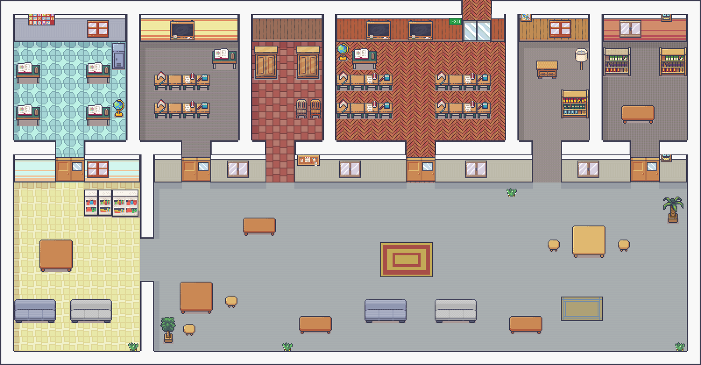

# Building map: design notes



`building_overlay.png` shows collision (red), locked doors (orange), keys (yellow numbered circles), item spots (orange squares), event spots (pink), goose spawns (G) and the player spawn (blue).

## Concept

The building is loosely based on the **Ron Cooke Hub**: a big open **Atrium** acts as the hub, with rooms around it. The aim is intuitive level design rather than a replica of the real building.

- One floor, 50 × 26 tiles (1600 × 832 px at 32 px per tile).
- Every locked door can be seen from the room the player approaches it from.
- The exit is visible from the start of the Lecture Theatre. It's a glass door with a green **EXIT** sign.
- The route makes the player cross the Atrium (where the geese are) again and again: west, north, far east, far west, then centre.

## Progression (5 keys)

| Step | Key found in | Opens | Leads to |
|---|---|---|---|
| 1 | Common Room (open from the start) | Door 1 | Seminar Room |
| 2 | Seminar Room | Door 2 | Study Space (far east) |
| 3 | Study Space | Door 3 | Lab (through the Common Room, far west) |
| 4 | Lab | Door 4 | Lecture Theatre (centre) |
| 5 | Lecture Theatre | Door 5 | **Exit** (fire exit in the Lecture Theatre's back wall) |

**Red-herring rooms:** the Storage Room and the Office are always open and contain nothing needed to finish. They have item and event spots for the team to fill.

`tools/map/validate_building_map.py` simulates this: with doors 1…N-1 open, exactly keys 1…N are reachable, door N can be reached, and the exit only becomes reachable at the end.

## What the map provides vs. what other systems do

The map holds **positions and doors only**. It has no rules for keys, items, events, scoring or geese.

| The map provides | Another system decides |
|---|---|
| `getKeySpot(n)`: where key *n* goes | Drawing keys, picking them up, the inventory |
| `unlockDoor(n)`, `isDoorLocked(n)`, `getLockedDoorNear(...)` | When a door gets unlocked (e.g. the player has key *n* and presses E) |
| `isAtExit(playerBounds)` | What happens on escape (win screen, score) |
| `getItemSpots()`: 8 open spots with a `room` property | Which item or power-up goes where |
| `getEventSpots()`, `getEventSpotsAt(bounds)`: 6 open trigger areas | What each event does, and whether it fires once |
| `getGooseSpawns()`, `randomGooseSpawn()`, `getSolids()` | Goose AI and spawning |
| `move(bounds, dx, dy)`, `isBlocked(r)`: collision incl. locked doors | Player controls |
| `getPlayerSpawn()`, `getRoomName(x, y)`, `isRedHerring(room)`, `clampCamera(cam)` | HUD and camera following |

Rendering is `renderBelow(camera)`, then the characters, then `renderAbove(camera)`. The tops of bookshelves, plants and fridges are drawn over characters, so you can walk behind them.

## Layers in `assets/maps/building.tmx`

| Layer | Kind | Contents |
|---|---|---|
| `floor` | tiles | Floors, wall faces, ceilings |
| `rugs` | tiles | Rugs (walkable) |
| `furniture` | tiles | Furniture, wall decorations, exit sign |
| `doors` | tiles | Closed door tiles; removed by `unlockDoor` |
| `above` | tiles | Tops of tall furniture, drawn over characters |
| `collision` | objects | Solid rectangles for walls and furniture (hidden in Tiled) |
| `doors` | objects | `locked_door` with `key`, `leadsTo`, `isExit` |
| `exit` | objects | The exit doorway |
| `spawns` | objects | `player_spawn` ×1, `goose_spawn` ×12 |
| `keys` | objects | `key_spot` ×5 with `key`, `opensDoor` |
| `items` | objects | `item_spot` ×8 with `room` (open) |
| `events` | objects | `event_spot` ×6 with `room`, `oneShot` (open) |
| `rooms` | objects | 8 named rooms with `redHerring` |

## Editing

- **Moving spots (keys, items, events, geese):** open `building.tmx` in [Tiled](https://www.mapeditor.org) and drag objects around. No code changes are needed.
- **Changing the layout or furniture:** edit the lists at the top of `tools/map/gen_building_map.py`, then run:
  ```
  python3 tools/map/gen_building_map.py --pack "path/to/Modern tiles_Free"
  python3 tools/map/validate_building_map.py
  ```
  The generator rebuilds the map and the collision, and **overwrites hand edits made in Tiled**. Agree as a group which method you're using.
- **Tile size:** add `--tile 16` or `--tile 48` to switch everything over. 32 is recommended, because one 48 px sheet is 4272 px tall, which some older GPUs can't load.

## Design decisions (for the report)

- **Hub-and-spoke layout.** The Atrium connects to every room, which keeps navigation simple under time pressure and makes the player keep passing through the geese.
- **Doors only on walls the player faces.** All locked doors sit on north walls, so the player always sees them face-on.
- **Visible goal.** The EXIT sign shows the player where to go without a tutorial.
- **Data-driven spots.** Keys, items, events and spawns live in the map file, not in code, so other systems and the customer's feedback can move them without touching Java.
- **Automated playthrough check.** This proves the 5-key chain works in order and can't be broken or skipped, and that every spot is reachable.
